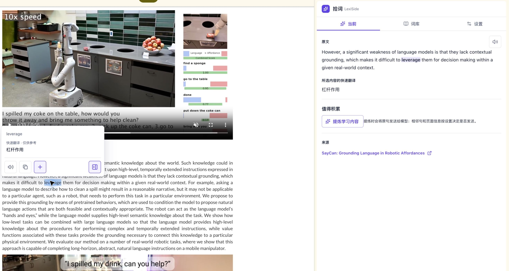
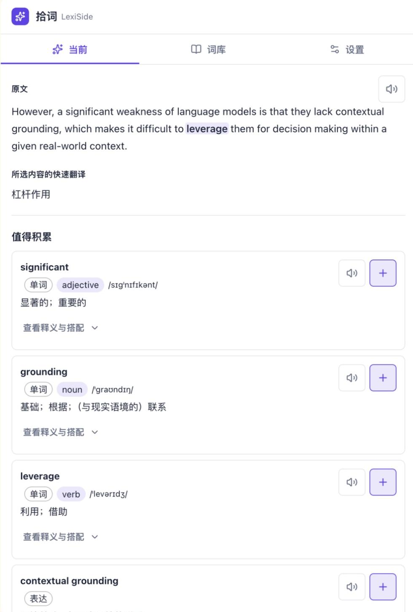
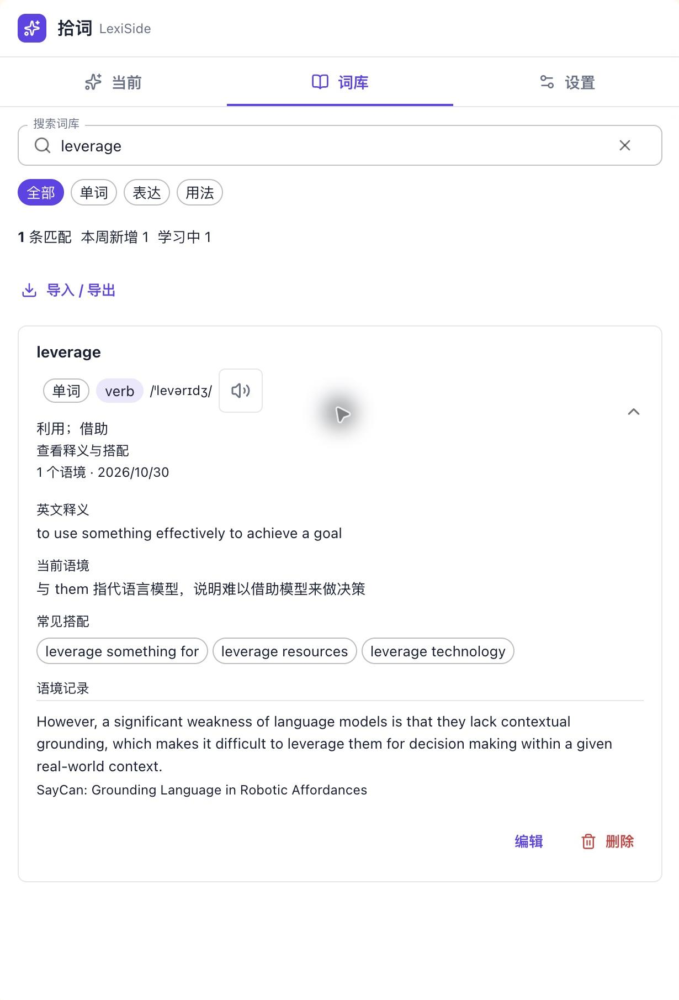

# 拾词 LexiSide

**读英文网页时，顺手把值得学习的词和表达留下来。**

拾词是一款桌面 Chrome 插件，可以在阅读英文论文、技术文档和文章时查词、理解语境，并保存词义、原句和网页来源。

[下载安装包](https://github.com/xdz97/lexiside/releases/download/v0.1.2/lexiside-0.1.2-chrome.zip) · [Release v0.1.2](https://github.com/xdz97/lexiside/releases/tag/v0.1.2) · [使用说明](INSTALL.txt) · [隐私说明](PRIVACY.md) · [版本说明](RELEASE_NOTES.md) · [问题反馈](https://github.com/xdz97/lexiside/issues)

> 本仓库同时提供插件源码、发行安装包、文档和使用截图；项目原创源码采用 MIT 许可证。安装包免费提供；DeepSeek 和豆包等外部服务需要你自己的 API Key，费用由对应服务商按用量收取。

## v0.1.2 更新

- 词库中的每条语境显示当时保存的含义；点击来源标题可在新标签页打开原网页。
- 旧记录没有含义时不显示空标签，缺少有效 HTTP(S) 来源时保留来源文字。
- 本地翻译等待超过 30 秒后进入既有 DeepSeek 回退流程，未配置 Key 时提示设置并允许重试。

## v0.1.1 更新

- 再次查到已收藏的词或表达时，展示旧原句、当时含义和可打开的来源；支持确认后追加当前语境。
- 每个词条默认保留最近 3 条语境，按保存顺序 FIFO 淘汰。可在「设置 → 数据与隐私 → 词库语境」调整为 1–100 条，移开焦点或按回车保存。
- 重复保存不刷新队列位置；调小上限立即裁剪，调大不会恢复已淘汰记录。旧版超额记录首次读取时裁剪，导入与恢复也遵守上限。
- 更新前建议导出 JSON 备份。将新版解压覆盖原安装目录，重新加载扩展并刷新网页；保留原路径以维持扩展 ID。

## 实际使用：读 SayCan 论文项目页

以下三张截图来自 v0.1.0 的真实使用过程；新增旧语境提示与语境数量设置见上述更新说明。

截图来自 [SayCan 项目页](https://say-can.github.io/) 的真实操作，仅裁剪了浏览器周边区域，没有替换插件界面或模型结果。网页及论文内容权利归原作者，本演示不代表对方为拾词背书。

### 1. 双击英文单词，就地理解

在普通英文网页双击单词，或选择短语后点击“译”，无需切换页面。快速翻译优先使用 Chrome 本地翻译；不可用时，在已配置 Key 的情况下回退到 DeepSeek。



### 2. 结合原句提炼学习内容

点击“提炼学习内容”，从原句里提炼值得积累的单词、表达与句型。默认手动触发，页面标题和来源域名默认不发送；可在设置中调整上下文范围。

图中的 leverage 快速译为“杠杆作用”，语境分析则给出“利用；借助”。这个例子也说明：快速翻译与 AI 分析都需要结合原文判断，不保证每次都正确。



### 3. 把词义、原句和网页来源一起保存

点击词条旁的“+”保存；在词库中搜索、回顾释义与搭配，保留当时读到的原句和来源。支持 JSON 备份/恢复、CSV 导出和用户授权的本机目录备份。



## 安装：桌面 Chrome 142+

1. 下载本页的 `lexiside-0.1.2-chrome.zip` 并解压到固定目录。
2. 在 Chrome 地址栏打开 `chrome://extensions`，开启右上角“开发者模式”。
3. 点击“加载已解压的扩展程序”，选择包含 `manifest.json` 的目录。
4. 打开英文网页使用。需要学习分析时，在拾词侧栏的“设置 → 翻译与 AI → DeepSeek Key 与连接”填入自己的 Key。

[DeepSeek 官方 Key 管理](https://platform.deepseek.com/api_keys)。连接检查通过不代表账户一定有可用余额。豆包 AI 朗读可选，不配置时可使用系统语音。

无需安装 Node.js、Companion 或本机 Host。本包尚未上架 Chrome Web Store，需要手动安装与更新。手机浏览器、小红书 App 内置浏览器和 Chrome 内部受限页面不适用。

校验下载文件：将本地 ZIP 的 SHA-256 与 [SHA256SUMS.txt](SHA256SUMS.txt) 对照。

## 数据、权限与费用

| 项目 | 说明 |
| --- | --- |
| 本机词库 | 词条、原句、来源和历史保存在浏览器本机，无账号和云同步 |
| 网站权限 | 为支持全站划词，在 HTTP/HTTPS 网页运行内容脚本；可关闭指定网站的交互 |
| 本地翻译 | 浏览器 API 和语言包可用时在本机完成；首次需联网下载语言包 |
| DeepSeek | 学习分析发送当前原句；翻译回退发送选中文本；上下文与页面元数据按设置决定 |
| 豆包语音 | 选择后，仅在音频缓存未命中时发送待朗读文本，并可能产生费用 |
| API Key | 浏览器本机扩展存储，非系统加密钥匙串；不进入词库或目录备份 |
| 收费边界 | 插件安装包免费；外部 API 费用由用户自己的服务商账户承担 |

完整说明见 [PRIVACY.md](PRIVACY.md)。请避免将含敏感信息的内容用于联网分析、翻译或朗读。

## 更新与备份

更新前先导出 JSON 或确认目录备份成功。将新版文件覆盖原目录，再到扩展管理页点击重新加载。不要随意更换加载目录或先卸载旧版，以免扩展 ID 变化或本机数据丢失。

卸载会删除扩展自身的数据和 Key；你授权目录中的外部备份不会随卸载删除，请自行保管。

## 第三方许可

本包包含 React、MUI、Zod、Lucide、Inter 字体等组件。完整版本、版权声明、许可条款和免责声明见 [THIRD_PARTY_NOTICES.txt](THIRD_PARTY_NOTICES.txt)。重新分发时请保留该文件及包内已有许可文件。

项目原创源码采用 [MIT](LICENSE)。第三方组件和截图中的第三方内容仍适用各自的许可与权利声明。

## 反馈

遇到安装问题或有功能建议，欢迎提交 [Issue](https://github.com/xdz97/lexiside/issues)，附上 Chrome 版本、操作步骤与报错即可，请勿上传 API Key 或私人词库。

文档与公开介绍遵循[对外文案约定](WRITING_STYLE.md)。

## 源码构建

需要 Node.js 22.12+ 与 npm 10+：

```bash
npm ci
npm run typecheck
npm test
npm run build
# 生成 ZIP：
npm run zip
```

静态扩展位于 `apps/extension/.output/chrome-mv3`。开发模式运行 `npm run dev`，并加载 `chrome-mv3-dev`；生产用户可直接下载 Release ZIP。当前源码只包含独立 Chrome 扩展、共享包和构建/测试工具，生产构建无需本机桥接服务。

`SOURCE_MANIFEST.json` 记录对应安装包的源码提交及公开文件哈希。`versions/` 保留安装包与同版本文档，历史版本不覆盖。语境、备份和 API Key 都是用户本机数据，不包含在源码中；请勿提交自己的数据或凭据。

## 许可证

项目原创源码采用 [MIT](LICENSE)。第三方组件和网页截图中的第三方内容仍遵循各自许可与权利声明，见 [THIRD_PARTY_NOTICES.txt](THIRD_PARTY_NOTICES.txt)。这不改变外部 AI 服务需要用户自行配置 Key 和承担费用的方式。
